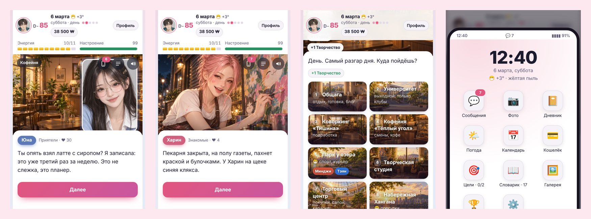
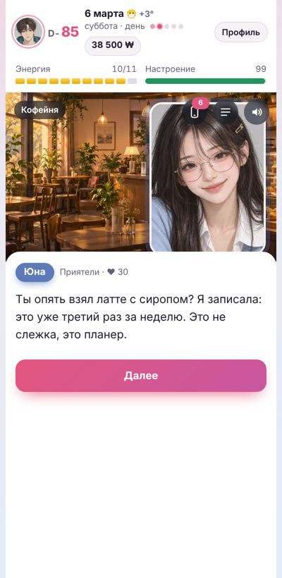
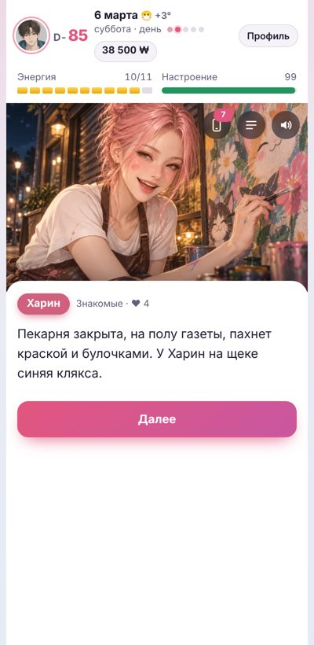
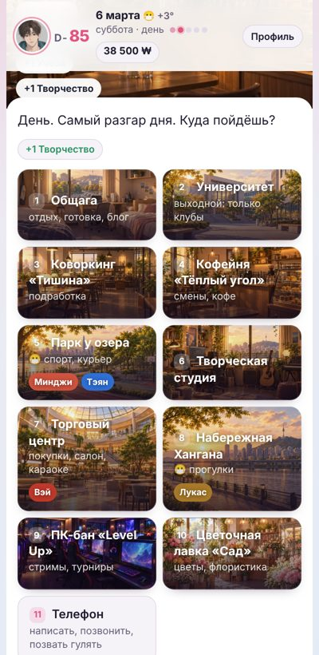
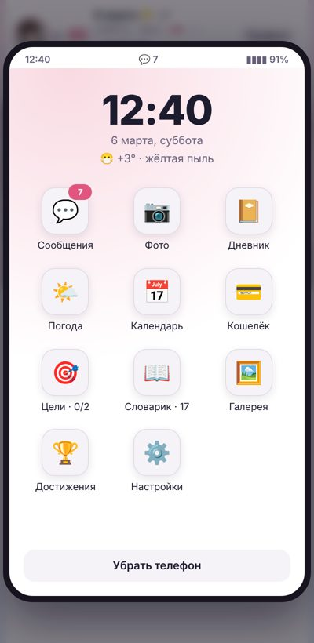
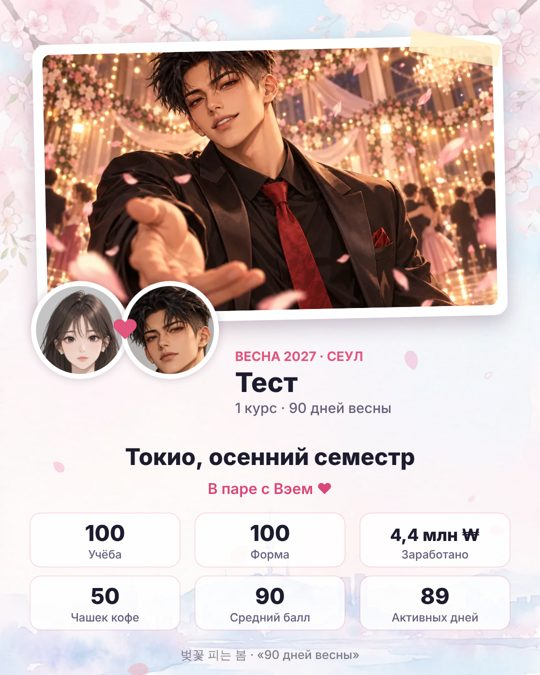

# 🌸 90 дней весны

**Визуальная новелла и симулятор жизни первокурсника в Сеуле**

Девяносто дней с 1 марта по 29 мая: учёба, подработки, друзья, любовь и весенний бал.

Бесплатно · без регистрации · браузер, Android, iPhone

## Об игре

Тебе девятнадцать, ты приезжаешь в Сеул на первый курс и заселяешься в комнату 413. До лета девяносто дней, а успеть хочется всё: сдать сессию, найти подработку, завести друзей и, может быть, влюбиться. Энергии на всё не хватит, поэтому каждый день — выбор.

- **Играй за парня или за девушку.** От этого зависит, с кем можно встречаться, а с кем — дружить.
- **14 персонажей со своими историями.** У каждого пять глав, свидания, любимые подарки и свой день рождения.
- **Сосед по комнате и староста.** Чанмин (или Йерин) и Суа — друзья с собственными линиями.
- **Выборы с последствиями.** Неудачное свидание может закончиться ссорой, а свидания сразу с двумя — неприятным разговором.
- **Жизнь в городе.** Пары, клубы, кофейня, ПК-бан, набережная Хангана, погода и распродажи по выходным.
- **Телефон героя.** Переписка, фото, дневник, календарь, кошелёк, погода, словарик корейских слов и цели весны.
- **15 концовок.** От обмена в Токио и киберспорта до концовки для тех, кто проспал всю весну.
- **Озвучка, музыка и иллюстрации к важным сценам.**
- **Три режима.** Полная весна на 90 дней, быстрая на 42 и экспресс на 21.

## Как играть

1. Открой **[kimekochi.github.io/vesna90-play](https://kimekochi.github.io/vesna90-play/)**.
2. На телефоне выбери в меню браузера «Добавить на главный экран». Игра установится как приложение и будет работать без интернета.
3. Прогресс сохраняется сам. Чтобы перенести сохранение между телефоном и компьютером, открой «Перенос сохранений» на главном экране.

## Кадры

 В конце весны можно сохранить карточку с итогами и отправить друзьям

Автор: [Kimekochi](https://github.com/Kimekochi)

